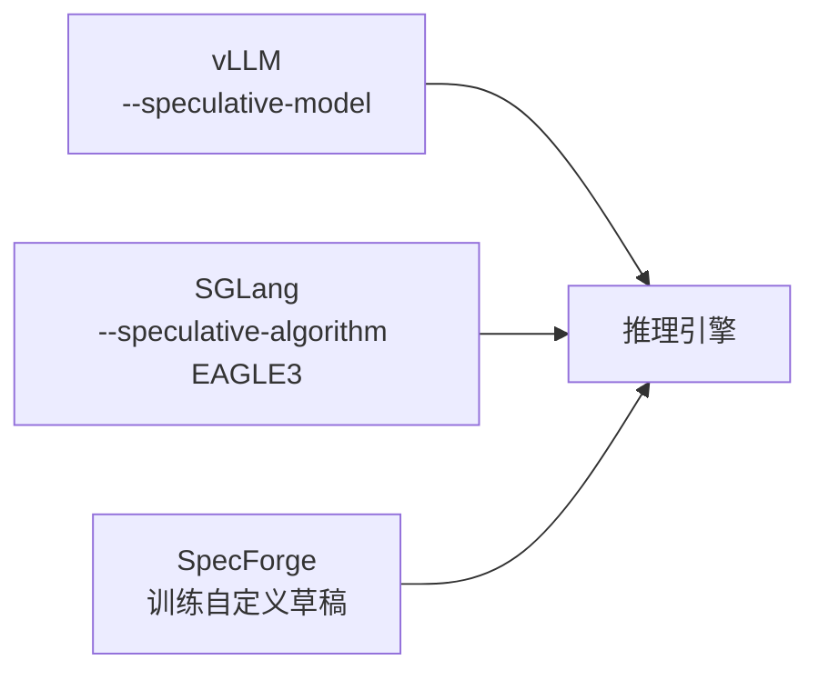

# 投机解码工程落地

## 核心结论

投机解码已是主流推理引擎的**标配能力**。工程落地关键在三点：**引擎启用方式、关键参数调优（草稿长度 K 等）、接受率生命线管理**。投机解码与量化/PagedAttention/CUDA Graph 等正交叠加，收益可累加。

## 引擎支持

- **vLLM**：`--speculative-model` 指定草稿模型、`--num-speculative-tokens`（即 K）设定候选数 [[3]](#ref-3)。
- **SGLang**：`--speculative-algorithm EAGLE3` 启用 EAGLE-3 草稿 [[5]](#ref-5)。
- **自定义草稿训练**：LMSYS [[SpecForge]] 开源框架，支持 EAGLE3、DFlash、Domino 等算法 [[6]](#ref-6)。

## 关键参数与调优

关键调参落在**草稿长度**与**验证预算**上：

| 参数 | 含义 | 建议 |
|------|------|------|
| 草稿长度 K | 单轮候选数 | 4–8，过大收益递减 |
| 树宽 | EAGLE 树形分支宽度 | 视接受率调优 |
| 验证预算（num-draft-tokens） | 单轮投放目标模型并行验证的 token 总量 | 平衡接受潜力与验证开销 |

两者共同决定单轮的**接受潜力**与**验证开销**。

## 接受率生命线与失效场景

**接受率是投机解码的生命线**，本质反映草稿与目标分布的契合度：

- **低于约 50%**：验证收益被重采样抵消、趋向**净负**。
- **40%–80%**：健康区间，越高加速越明显。

主要失效场景：
- 高并发 QPS 下与连续批处理争抢资源。
- 草稿与目标 tokenizer 或行为不匹配。
- 显存紧张放不下草稿。

**最佳适用场景**：单用户低延迟（聊天、Agent、代码补全）与输入输出高重复（RAG、摘要、代码）。

## 与其他加速技术正交叠加

投机解码作用于 Decode 的**访存摊薄**，与以下技术在目标层面正交、可在同一引擎中叠加：

- **量化**（FP8/INT4）：压缩权重传输、降低访存压力。
- **PagedAttention / KV Cache**：优化显存、放大 batch。
- **CUDA Graph / FlashAttention**：降低 kernel 启动与开销。

正交叠加使收益可累加，是工程上常见组合 [[3]](#ref-3)。

## 相关页面

- [[投机解码]]：机制主概念
- [[草稿模型分类]]：草稿选型
- [[期望接受长度]]：收益量化
- [[EAGLE]]：推荐草稿方案
- [[vLLM]]：主流推理引擎
- [[KV Cache优化技术栈总览]]：正交叠加的优化栈

## 参考来源

- [[raw/papers/投机解码.md]]

[3] vLLM Project. "Speculative Decoding (vLLM Docs)." *vLLM Documentation*, 2025.
[5] Y. Li, F. Wei, C. Zhang, H. Zhang. "EAGLE-3: Scaling up Inference Acceleration of Large Language Models via Training-Time Test." *NeurIPS*, 2025.
[6] The SpecForge Team. "SpecForge v0.3.0: a Unified Disaggregated and Colocated Speculative Decoding Stack." *LMSYS Blog*, 2026.