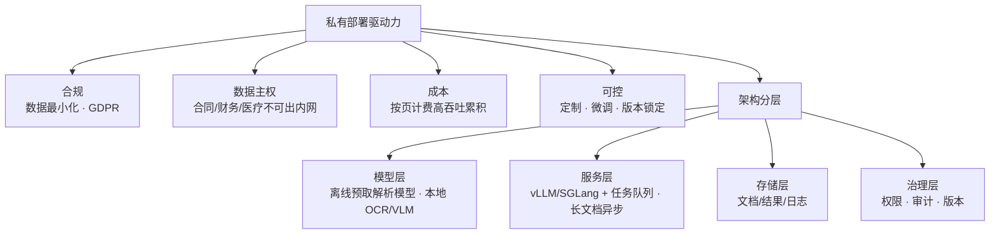

# 文档智能工程落地

## 简介

主题总览：把 [[文档智能]]（四段能力链）从解析到业务跑通的完整工程路径。本文汇总解析、校验、部署、评估、边界各环节，指向各原子页面。

## 解析层五支线

解析段由五个 [[文档智能]] 子能力构成，各有独立难点：

1. [[OCR文档解析]] — 字符识别与六条结构性局限
2. [[版面分析]] — 布局、阅读顺序、层级
3. [[表格结构还原]] — 表格二维结构（TableFormer）
4. [[公式识别]] — 数学结构序列化（CDM 评测）
5. [[文档VLM三大范式]] — 传统流水线 / 端到端 / 解耦式架构选型

## 两条工程路线

- [[MinerU]]：自研高精度解析 VLM（解耦式两阶段），追求最高解析精度。
- [[Docling]]：统一文档模型 + 可插拔流水线，追求可编排、多格式、RAG 分块。
- 对比见 [[MinerU与Docling对比]]。

## 校验五步法

可校验是文档智能区别于普通 OCR 的核心，落地走五步法：采集 → 分类 → 提取 → 审核 → 录入，其中**审核环节不能省**，兜底闭环"抽取—规则校验—转人工"。详见 [[文档智能校验三支柱]]。

## 私有部署

**四驱动力**：合规（上传云端可能被用于训练，违反数据最小化原则；EDPB 指出大量个人数据训练 OCR 模型可能违反 GDPR）、数据主权（合同/财务/医疗/证件类不可出内网）、成本（按页计费高吞吐累积）、可控（定制、微调、版本锁定）。

**架构分层**（原文标注【推导】）：模型层（离线预取解析模型、本地 OCR 与 VLM）、服务层（vLLM/SGLang + 任务队列、长文档异步化）、存储层、治理层。

**三陷阱**：隐写文本层（文档含不可见/隐写文本，解析时易混入）、资源超限静默死（高吞吐下资源耗尽无告警）、版本升级缺回归（升级后缺回归测试导致精度回退）。

## 精度评估与边界

- 三层指标与四陷阱：[[文档精度评估三层]]；公开基准 [[OmniDocBench]]。
- 六条能力边界：[[文档智能能力边界]]。

## 与 Agent / RAG 的融合

- **RAG 分块**：Docling 的 HybridChunker 让每个 chunk 自带 `headings` 路径与 `prov` 坐标直接入库。
- **文档是 Agent 的感官**：文档智能作为 Agent 的外部结构化输入通道（见 [[文档智能能力边界]]）。

## 相关

- [[文档智能]]、[[文档智能校验三支柱]]、[[文档精度评估三层]]、[[MinerU与Docling对比]]